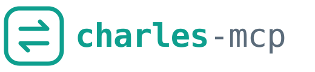

<p align="center">
  
</p>
<p align="center">
  <em>Live Charles Proxy traffic for your AI coding agent. Native, read-only, private by default.</em>
</p>
<p align="center">
  <a href="https://github.com/chancecreate/charles-mcp/actions/workflows/ci.yml"></a>
  
  
  
  <a href="LICENSE"></a>
</p>

---

**Documentation**: [docs/](docs/) · **Source**: [github.com/chancecreate/charles-mcp](https://github.com/chancecreate/charles-mcp)

---

charles-mcp lets MCP clients like Claude Code, Codex and Cursor read the HTTP(S) traffic that
[Charles Proxy](https://www.charlesproxy.com/) is capturing, while it's being captured.

A small bridge runs inside Charles and listens to every request and response through Charles's own proxy
API. Your agent asks something like *"why is the checkout call returning 422?"* and answers it from traffic
that's actually on the wire. You don't need to export sessions, and the Web Interface isn't polled.

The key features are:

* **Live**: events come out of Charles as requests start, get responses and finish, with Charles's own timestamps.
* **Native**: hooks Charles's public listener API, so no Charles bytecode is modified.
* **Private by default**: credentials are redacted twice, bodies stay off until you enable them, and the bridge
  only answers authenticated local clients.
* **Safe for Charles**: queues are bounded and nothing blocks a proxy thread. If the bridge stops, Charles carries on.
* **Token-efficient**: compact, paginated, typed tool results, with cursors for "what's new since last time?"
* **Read-only**: no replay, no traffic modification, no certificate access. It's an inspection tool.

## Quickstart

No build tools needed. You need Charles Proxy **4.6.x** on Windows ([4.6.8](https://www.charlesproxy.com/download/previous-release/) is the latest) and [Python **3.11+**](https://www.python.org/downloads/).

1. Download `charles-mcp-<version>-windows.zip` from the [latest release](https://github.com/chancecreate/charles-mcp/releases/latest) and unzip it.
2. Close Charles, then double-click **`Install.cmd`**. Click *Yes* when Windows asks for permission.
3. Start Charles. If you use Claude Code, it's already connected. Just ask about your traffic.

To remove it, double-click **`Uninstall.cmd`**.

## Installation from source

Requirements: Charles Proxy **4.6.x** on Windows, Python **3.11+**, and JDK **11+**.

Build the agent and install it into Charles. Run this from an elevated PowerShell if Charles is in
`Program Files`. The installer backs up `Charles.ini`, and `-Uninstall` puts it back.

```console
$ cd java && ./mvnw -B package && cd ..
$ .\scripts\install-windows.ps1
```

Then install the MCP server:

```console
$ pip install ./python
```

## Example

### Connect it

Add the server to your MCP client. For Claude Code:

```console
$ claude mcp add charles -- charles-mcp
```

Configs for Codex and Cursor are in [examples/](examples/).

### Check it

Restart Charles, browse something, then run:

```console
$ charles-mcp status
{
  "bridge_connected": true,
  "charles_version": "4.6.8",
  "recording": true,
  "session_id": "s-cd075c67",
  ...
}
```

### Ask it

Your agent now has these tools:

| Tool | What it does |
| --- | --- |
| `list_requests` | Recent requests, newest first. Filter by host, method, status, URL, content type or time. Pass `after` to get only new ones. |
| `get_request` | Method, URL, headers, timing and sizes, plus the body if you ask for it. |
| `get_response` | Status, headers, timing, TLS details and errors, plus the body if you ask for it. |
| `search_traffic` | Searches URLs, headers and (if enabled) bodies, and returns snippets. |
| `get_session_summary` | Counts by host, method and status, recent errors and totals. |
| `watch_requests` | Raw lifecycle events since a cursor. |
| `get_status` | Bridge health, recording state and drop counters. |

Here's a `get_response` result from a live capture, trimmed, with secrets already redacted:

```json
{
  "status": 200,
  "state": "complete",
  "headers": [
    { "name": "Content-Type", "value": "application/json; charset=utf-8" },
    { "name": "Set-Cookie", "value": "[REDACTED]" }
  ],
  "body": {
    "kind": "json",
    "text": "{ \"user\": \"demo\", \"access_token\": \"[REDACTED]\", \"profile\": { \"password\": \"[REDACTED]\", \"plan\": \"free\" } }",
    "untrusted": true
  }
}
```

## Request bodies

Bodies are **off** by default. Turn them on when you need them:

```console
$ claude mcp add charles --env CHARLES_MCP_ALLOW_BODIES=1 -- charles-mcp
```

Even when they're on, bodies are size-capped and redacted, and binary content is never decoded into text.
Captured content is also marked as untrusted, so your agent treats it as data rather than instructions.

Host filters limit what the agent can see:

```toml
# charles-mcp.toml
[charles_mcp]
allow_bodies = true
host_allowlist = ["api.example.com", "*.staging.example.com"]
```

Every setting is listed in [examples/charles-mcp.toml](examples/charles-mcp.toml).

## How it works

```text
 Charles 4.6.x                                 charles-mcp                     your agent
┌─────────────────────────────────────┐      ┌──────────────────────┐      ┌──────────────┐
│ proxy ─▶ listener ─▶ bounded queue  │      │ index ─▶ redaction   │      │ Claude Code  │
│       ─▶ event store ─▶ bridge      ├─────▶│       ─▶ MCP tools   │◀────▶│ Codex        │
│         127.0.0.1 · token auth      │ TCP  │                      │stdio │ Cursor       │
└─────────────────────────────────────┘      └──────────────────────┘      └──────────────┘
```

Charles's bundled Java runtime can't load `-javaagent`, so the installer points `Charles.ini` at a tiny
launcher instead. The launcher starts the bridge and then hands control to Charles as usual. More detail is
in [architecture](docs/architecture.md) and the [internals notes](docs/reverse-engineering-findings.md).

## Security

Your MCP client may send tool output to a cloud model, so only enable bodies for traffic you'd be fine
sharing, and use host allowlists. Redaction works from header and key names and from known token formats,
which means a secret with no recognisable name or shape can get through. The full threat model is in
[docs/security.md](docs/security.md).

## Troubleshooting

| Symptom | Fix |
| --- | --- |
| `discovery file not found` | Charles isn't running with the bridge. Re-run the installer and restart Charles. |
| `stale discovery file` | Charles exited abruptly. Restart it. |
| `recording: false` | Start recording in Charles. |
| Requests from your app are missing | Check that the app uses Charles as its proxy, and check your host filters. |
| `agent_state: unsupported` | Your Charles version isn't supported yet, so the bridge stays off. Charles still runs normally. |

## Development

```console
$ cd java && ./mvnw -B verify
$ cd python && pip install -e ".[dev]" && pytest
```

To try the tools without Charles, run the mock bridge and point the server at its discovery file:

```console
$ charles-mcp mock-bridge --fixture fixtures/sample-bridge.json --discovery ./mock.json
$ CHARLES_MCP_DISCOVERY_FILE=./mock.json charles-mcp
```

See [testing](docs/testing.md) and [contributing](CONTRIBUTING.md).

## License

This project is licensed under the terms of the [MIT license](LICENSE).

Charles Proxy is a product of XK72 Ltd. This project isn't affiliated with or endorsed by XK72.
