# Architecture

```mermaid
flowchart LR
    subgraph JVM["Charles 4.6.x JVM (unchanged Charles bytecode)"]
        direction TB
        PX["Proxy threads"] -->|"ProxyListener callbacks<br/>(after the session recorder)"| L["LifecycleListener<br/>(dynamic proxy)"]
        L -->|"non-blocking offer()<br/>immutable snapshot + weak ref"| Q[("bounded queue<br/>drop + count when full")]
        Q --> W["worker thread"] --> S[("EventStore<br/>events + latest txn state<br/>bounded by count/age/bytes")]
        S --> B["BridgeServer<br/>127.0.0.1:ephemeral<br/>token auth, NDJSON"]
        B -. "bounded body read<br/>(on request only)" .-> T["live Transaction<br/>(WeakReference)"]
    end
    D[["%LOCALAPPDATA%\charles-mcp\bridge.json<br/>port + 256-bit token<br/>owner-only ACL"]]
    B -- writes --> D
    subgraph PY["charles-mcp sidecar (Python, stdio)"]
        C["BridgeClient<br/>reconnects, re-reads discovery"] --> I["TrafficIndex<br/>cursor sync, host filters"]
        I --> R["Redactor + body filter"] --> M["FastMCP tools"]
    end
    D -. reads .-> C
    C <-->|"loopback TCP"| B
    M <-->|"MCP over stdio"| A["MCP client<br/>(Claude Code, Codex, Cursor…)"]
```

## Components

| Module | Path | Responsibility |
| --- | --- | --- |
| **Launcher / entry** | `java/agent/.../Launcher.java`, `AgentMain`, `JavaAgentEntry` | Start the bootstrap thread, then hand control to `com.xk72.charles.gui.MainWithClassLoader`. `-javaagent` supported on full JDKs. |
| **instrumentation** | `java/agent/.../instrumentation/` | `CharlesApi` resolves and *verifies* the internals used (by name for public APIs, by signature + observed effect for obfuscated ones). `LifecycleListener` maps callbacks to events. `SnapshotFactory` copies metadata. `BodyReader` does bounded, off-thread body reads. `CharlesHook` wires it all and is the bridge backend. |
| **events** | `java/agent/.../events/` | `EventPipeline` (bounded `ArrayBlockingQueue`, never blocks), `EventStore` (sequenced log + transaction table, all bounded), immutable `TransactionSnapshot`/`BridgeEvent`. |
| **bridge** | `java/agent/.../bridge/` | `BridgeServer` (auth, limits, read-only ops), `WireFormat` (versioned JSON), `Discovery` (atomic, owner-only file). |
| **schemas** | `schemas/bridge-event.v1.schema.json` | Stable event contract (also the integration point for a future RequestFlow analyzer). |
| **mcp** | `python/src/charles_mcp/` | `bridge_client`, `index`, `redaction`, `bodies`, `models` (Pydantic), `server` (FastMCP), `mock_bridge`, `cli`. |
| **tests** | `java/*/src/test`, `python/tests` | Unit + socket-level + MCP-protocol tests against clean-room test doubles and synthetic fixtures. |

## Threading and safety rules inside Charles

* The listener runs on Charles's proxy threads and does only: two attribute lookups, ~30 getter calls,
  small list copies of headers (capped), and one non-blocking `offer()`. Body-chunk callbacks return
  immediately. Every callback is wrapped in a catch-all; errors are counted, never propagated.
* No IO on proxy threads (the optional debug log is the only exception and is off by default).
* Bodies are never copied at capture time. The store keeps a `WeakReference` to the Charles `Transaction`;
  a client request for a body reads at most `maxBodyBytes + 1` bytes on the bridge connection thread.
  If Charles has dropped the transaction (session cleared, GC), the body is reported unavailable.
* All limits are clamped (`AgentConfig`): events (20k), transactions (5k), age (6 h), retained bytes
  (64 MiB), queue (8192), connections (4), body bytes (1 MiB hard cap 16 MiB).
* The bridge has no write operations. Charles works identically with the sidecar absent; a stalled or
  hostile client only occupies its own bridge thread (verified: proxy latency unchanged with stalled
  clients, see IMPLEMENTATION_STATUS.md).

## Identity and cursors

* `transaction_id` (`t<n>`): assigned on first sighting of a `Transaction` object, stored on the
  `ProxyEvent` with a private attribute key together with a weak reference to the Transaction. If Charles
  swaps in a new Transaction for the same event (tunnels after a session switch), a new id is issued.
  Redirects and keep-alive reuse produce new Transactions and therefore new ids.
* `event_id`: strictly increasing per bridge process; clients page with `after=<cursor>`. If events were
  evicted before a client read them, the page says `gap: true`.
* `session_id` (`s-xxxxxxxx`): generated per Charles recording `Session` object; `session_changed` is emitted
  when it changes. "Clear session" keeps the same Session object; cleared transactions report
  `attached_to_session: false`.
* A Charles restart means a new process: new port, token, `pid`/`started_ms` in the discovery file. The
  sidecar detects the change (discovery file mtime / identity) and resets its index.

## Timing semantics

`timing.start_ms` / `end_ms` / `duration_ms` and the request/response begin/complete times are Charles's own
timestamps (copied from the Transaction). `timestamp_ms` on an event is when the bridge observed the
callback. `duration_ms = end_ms - start_ms`.

## Bridge protocol (v1)

Newline-delimited JSON over TCP on `127.0.0.1`. The first message must be
`{"op":"hello","token":"<from discovery file>"}`. Then:

| op | params | result |
| --- | --- | --- |
| `status` | — | versions, agent state, recording, session id, queue/drop counters, limits |
| `events` | `after`, `limit` (≤1000) | `events[]`, `next_cursor`, `oldest_event_id`, `latest_event_id`, `gap`, `has_more` |
| `transaction` | `transaction_id`, `include_request_body`, `include_response_body`, `max_body_bytes` | latest snapshot: request/response line + headers (redacted), timing, connection/TLS info, optional base64 bodies with `truncated`/`decoded` flags |
| `ping` | — | `{"pong": true}` |

Requests are capped at 64 KiB per line. Authentication must happen within 5 s.

## Why a launcher instead of bytecode instrumentation?

Charles 4.6.x already exposes exactly the lifecycle callbacks we need through `ProxyListener`, so there is
nothing to instrument. Registering a listener through Charles's own API is smaller, survives more
internal change, and can be verified at runtime. The only reason not to use `-javaagent` is that Charles's
bundled runtime lacks `java.instrument`; a wrapper main class in `Charles.ini` is the least invasive way in.
